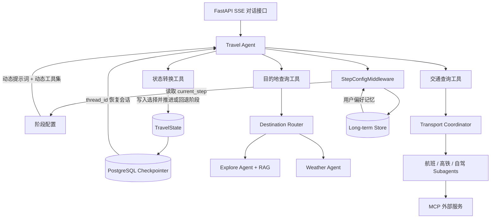

# LangGraph 旅行规划 Agent

这是一个状态驱动的多阶段旅行规划项目。它的核心不是某一个 Subagent，而是：**同一个 Travel Agent 如何依据共享状态切换规划阶段，在每个阶段动态获得不同提示词和工具，并通过持久化状态完成可回退的多轮规划。**

## 项目亮点

- 八阶段状态机驱动规划，支持显式推进、校验和回退；
- LangGraph Checkpointer 保存会话进度，Store 保存跨会话用户偏好；
- Destination Router 并行聚合攻略检索和天气信息；
- Transport Coordinator 以 Agent-as-Tool 方式调度交通子 Agent；
- 混合检索、重排序和父子文档映射组成完整 RAG 链路；
- FastAPI + SSE 提供流式对话和工具调用事件；
- Docker Compose 一次启动前端、后端、PostgreSQL 和 Redis。

## 核心流程

```text
需求收集 → 目的地推荐 → 交通规划 → 住宿规划 → 餐饮规划 → 行程生成 → 预算汇总 → 订单生成
```

每个阶段都由 `TravelState.current_step` 标识。阶段工具在记录用户确认结果的同时更新 `current_step`；下一轮模型调用再由 `StepConfigMiddleware` 注入该阶段对应的提示词、可用工具和前置状态校验。



## 关键设计

### 1. 共享状态与阶段推进

`app/core/state.py` 定义完整的 `TravelState`，包括当前阶段、用户需求、各环节选择、查询结果、行程和预算。`app/tools/state_transition.py` 中的工具负责修改状态：例如确认目的地后进入交通规划，确认交通后进入住宿规划。

状态转换不是隐藏在提示词中的约定，而是工具返回的显式状态更新，因此流程可以持久化、检查和回退。

### 2. 动态 Agent 配置

`app/agents/handoffs/step_config.py` 为每个规划阶段定义：

- 当前阶段的系统提示词；
- 允许模型调用的工具；
- 进入该阶段所需的状态字段。

`app/core/middleware.py` 在每次模型调用前读取 `current_step`，校验前置状态，注入长期记忆，再替换提示词和工具集。这样不用为八个阶段分别维护八个顶层 Agent，同时避免模型在错误阶段调用无关工具。

### 3. 短期状态与长期记忆分离

- Checkpointer 按 `thread_id` 保存一次会话中的 LangGraph 状态，用于恢复规划进度。
- Store 按 `user_id` 保存旅行风格、饮食禁忌、住宿偏好和历史行程，用于跨会话个性化。

长期记忆由 Middleware 读取并注入当前阶段提示词；写入则通过 Memory Tools 完成。

### 4. Router 与 Subagent 是局部能力

- Destination Router 使用 `Send` 将查询分发给攻略检索和天气节点，再合并结果；它展示的是 LangGraph 的条件路由和并行分发。
- Transport Coordinator 将航班、高铁、自驾 Agent 包装成工具；它展示的是 Agent-as-Tool 的任务委派。

它们都服务于主旅行规划流程，并不是系统本身的顶层控制器。

### 5. API 与生命周期

FastAPI 启动时初始化 Checkpointer、Store 和 MCP Client。聊天接口使用 SSE 输出模型 token 与工具调用事件，并把 `conversation_id` 作为 LangGraph 的 `thread_id`，使 HTTP 会话与 Agent 状态对应。

## 代码入口

| 内容 | 文件 |
|---|---|
| 主 Travel Agent 装配 | `app/agents/handoffs/travel_agent.py` |
| 各阶段提示词和工具配置 | `app/agents/handoffs/step_config.py` |
| 动态阶段中间件 | `app/core/middleware.py` |
| 共享状态定义 | `app/core/state.py` |
| 状态推进与回退 | `app/tools/state_transition.py` |
| 目的地并行 Router | `app/agents/routers/destination_router.py` |
| 交通 Coordinator/Subagents | `app/agents/subagents/` |
| Checkpointer 与长期 Store | `app/core/checkpointer.py`、`app/core/store.py` |
| SSE 对话接口 | `app/api/v1/chat.py` |
| Web 前端 | `frontend/index.html` |

## 本地运行

### Docker Compose（推荐）

项目要求 Docker Desktop。复制环境变量模板并填写 `DASHSCOPE_API_KEY`：

```bash
cp .env.example .env
docker compose up --build
```

Windows PowerShell 可使用：

```powershell
Copy-Item .env.example .env
docker compose up --build
```

启动完成后：

- Web 前端：`http://127.0.0.1:5500`
- OpenAPI 文档：`http://127.0.0.1:8001/docs`
- 存活检查：`http://127.0.0.1:8001/api/v1/health/live`
- 就绪检查：`http://127.0.0.1:8001/api/v1/health/ready`

宿主机端口可通过 `.env` 中的 `FRONTEND_PORT`、`BACKEND_PORT`、`POSTGRES_EXPOSE_PORT` 和 `REDIS_EXPOSE_PORT` 修改。容器之间始终使用服务名和容器端口通信。

### Python 本地运行

项目要求 Python 3.11 或更高版本，并依赖 PostgreSQL 和 Redis。外部 MCP 服务默认关闭。

```bash
python -m venv .venv
# Windows
.venv\Scripts\activate
pip install -c constraints.txt -r requirements.txt
```

复制 `.env.example` 为 `.env`，填写实际配置，然后运行：

```bash
python -m scripts.init_db
python -m scripts.init_rag
python -m app.run
```

启动后访问 `http://localhost:8000/docs` 查看后端接口文档。

另开一个终端启动前端静态服务器：

```bash
python -m http.server 5500 --bind 127.0.0.1 --directory frontend
```

然后访问 `http://127.0.0.1:5500/`，并在登录框的“连接设置”中将后端地址改为 `http://127.0.0.1:8000`。前端默认使用 Docker 对外端口 `8001`。

推荐的本地启动顺序是：

1. 启动 PostgreSQL 和 Redis；
2. 初始化数据库；
3. 启动 FastAPI 后端；
4. 启动前端静态服务器。

Compose 会在后端启动前自动执行幂等的数据库初始化。

## 测试

```bash
python -m compileall -q app scripts
pytest -q tests/test_state_transitions_unit.py
```

仓库中的 GitHub Actions 会在推送和拉取请求时执行相同的基础检查。

## 当前实现边界

- Destination Router 的天气节点仍返回示例内容，尚未接入真实天气 MCP。
- Transport Coordinator 中航班工具当前被主动禁用，高铁与自驾为启用状态。
- 完整流程依赖模型、PostgreSQL、Redis 和远程 MCP，可脱离外部服务运行的单元测试仍不完整。
- 根目录 `main.py` 是早期的 Redis Checkpointer 示例；正式 FastAPI 入口是 `app/run.py`。

## 配置与安全

- 本地密钥只保存在 `.env`，该文件已被 `.gitignore` 忽略；
- 仓库只提交不含真实密钥的 `.env.example`；
- 不要在前端代码中填写模型 API Key，所有模型调用都由后端完成。

## 参与贡献与许可证

贡献方式参见 `CONTRIBUTING.md`，安全问题参见 `SECURITY.md`。本项目采用 MIT License。
